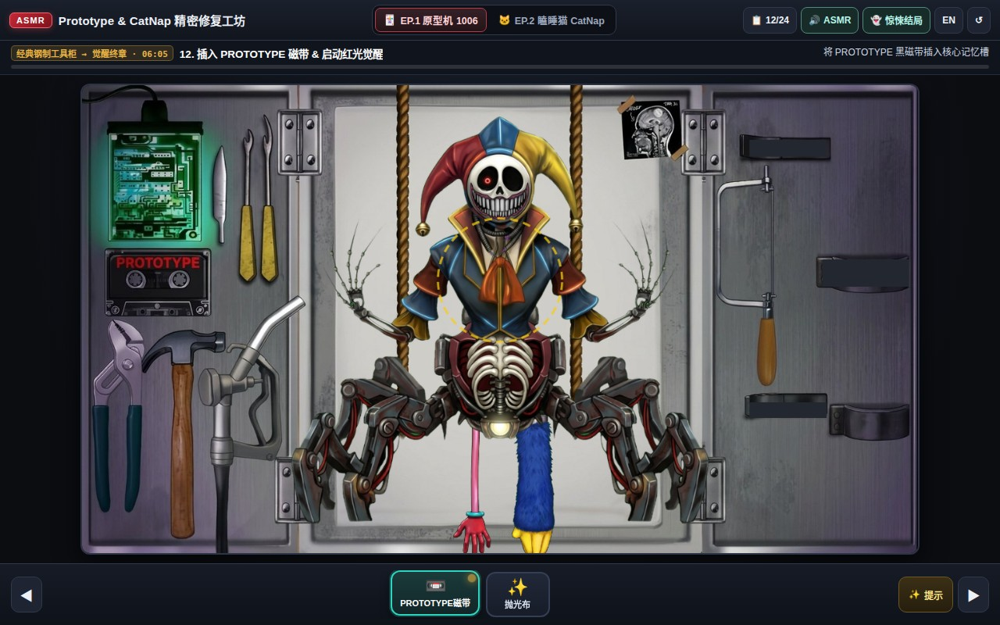

# 🃏🐱 ASMR Prototype & CatNap Doll Restoration Studio (`Poppy Playtime 4`)

👉 **Live Playable Studio (GitHub Pages)**: **[https://kunruiw1991.github.io/prototype-doll-asmr-repair/](https://kunruiw1991.github.io/prototype-doll-asmr-repair/)**



An ultra-faithful, zero-build **24-step interactive ASMR Doll Restoration Studio** recreating the entire **14:41** SmileBam animation **[`youtu.be/6Nw7Hi4Xr9s`](https://youtu.be/6Nw7Hi4Xr9s)** (*ASMR Repairing the Abandoned Prototype Doll | Poppy Playtime 4 | Doll Restoration*), covering **both complete restoration episodes** across **6 hand-illustrated interactive rooms** with procedural Web Audio ASMR synthesis, Desktop + iPad Safari touch controls, CN/EN bilingual switching, and a `👻 Spooky / ✨ Cozy` finale toggle.

---

## 🎬 Frame-by-Frame Recreation Map (`youtu.be/6Nw7Hi4Xr9s`)

### Episode 1 — The Prototype (Experiment 1006 Jester Spider Doll) · `00:00–06:35`

| Step | Timestamp | Room | Authentic Recreated Action & Props |
| :---: | :---: | :--- | :--- |
| **01** | `00:45` | White-Tile Lab Desk | Pull embedded dagger from Prototype's skull mask with surgical pliers |
| **02** | `01:05` | White-Tile Lab Desk | Open mustard lab fridge, scoop dried golden brain into metal bucket with dual metal spoons, implant glowing green fresh brain |
| **03** | `01:35` | 90s CRT Monitor | Type with teal-gloved hands to sync the neon-green dual-hemisphere EEG brainwave to 100% |
| **04** | `01:55` | White-Tile Lab Desk | Stitch missing red jester hat horn & golden bell, scrub jagged vertical teeth sparkling clean |
| **05** | `02:25` | Green Experiment Chamber | Lower mechanical spine from overhead blue crane & ratchet-bolt pelvis headlight joint |
| **06** | `03:05` | Green Experiment Chamber | Press green GrabPack handprint scanner on crimson specimen tank & snap curved white bone ribs into armored carapace |
| **07** | `03:45` | Green Experiment Chamber | Open blue trophy locker & retrieve Huggy Wuggy's furry blue arm and Mommy Long Legs' pink stretchy arm |
| **08** | `04:15` | Iconic Steel Tool Cabinet | Swing open double steel doors (green PCB, X-ray `OLIVER 1006`, ropes), bolt 6 articulated spider legs & dock torso |
| **09** | `04:40` | Iconic Steel Tool Cabinet | Heat crimson blueprint forge & attach iconic needle-fingered Experiment 1006 mechanical claw hands |
| **10** | `05:05` | Iconic Steel Tool Cabinet | Coat dirty Prototype & pink crayon scribbles in fluffy white ASMR foam, then blast spotless with high-pressure water jet |
| **11** | `05:35` | Iconic Steel Tool Cabinet | Graft Mommy Long Legs' pink arm & Huggy Wuggy's blue arm neatly beneath the spider ribcage |
| **12** | `06:05` | Steel Cabinet → Lab Finale | Insert red-labeled `PROTOTYPE` cassette tape, buff skull mask & golden bells → Red-Alert Awakening Finale! |

### Episode 2 — Abandoned CatNap Plush (`Poppy Playtime 3/4`) · `06:40–14:41`

| Step | Timestamp | Room | Authentic Recreated Action & Props |
| :---: | :---: | :--- | :--- |
| **13** | `06:50` | Abandoned Playcare Room | Inspect aged `REPORT` clipboard & screw in overhead bare lightbulb to illuminate abandoned CatNap |
| **14** | `07:15` | Abandoned Playcare Room | Surgical tweezers extract torn-ear splinters, dangling red-thread eyeball & stuck cheek blade/tag |
| **15** | `07:55` | Abandoned Playcare Room | Snip loose frayed threads, spray red-yellow aerosol stain mist & clear rusty wire arm pins |
| **16** | `08:45` | `SMILE BAM` Laundry Room | Load muddy CatNap into vintage `SMILE BAM` front-loading washer, pour blue detergent & run bubbly spin cycle |
| **17** | `09:15` | `SMILE BAM` Laundry Room | Blow-dry wet purple plush fur warm and fluffy with silver hair dryer |
| **18** | `09:45` | Wooden Tailor Workbench | Trim loose edges, stitch forehead & ear tears with purple thread, install clean red cassette voice box inside torso |
| **19** | `10:25` | Wooden Tailor Workbench | Stuff plump clouds of fresh white cotton from the smiling-critter stuffing bag |
| **20** | `10:50` | Wooden Tailor Workbench | **Iconic SmileBam Fabric Gag**: test Yellow (`❌`) & Blue (`❌`) cloth → select `CATNAP` Purple (`✅`), cut & stitch patches! |
| **21** | `12:05` | Tailor Bench Face Close-Up | Cross-stitch two glossy black button eyes neatly into CatNap's sockets |
| **22** | `12:30` | Wooden Tailor Workbench | Replace rusty wire arm with brand-new stuffed purple plush arm & blend seams smooth with silver purple-dye airbrush |
| **23** | `12:55` | Wooden Tailor Workbench | Groom velvety plush fur with wooden oval hairbrush & reattach curled purple tail |
| **24** | `13:25` | Playcare Room Finale | Polish golden Crescent Moon pendant with white tube, place dark Red-Smoke Scent Capsule inside mouth → Nightmare / Cozy Finale! |

---

## 🎮 Controls (Desktop & iPad Safari Touch)

- **Drag / Pull / Scrub / Hold** directly on the glowing golden target ring on the canvas (works seamlessly with mouse or 1-finger iPad touch).
- **Bottom Tool Dock**: Pick tools (or try the Yellow/Blue fabric gag swatches in Step 20!), navigate steps (`◀` / `▶`), or tap `✨ 提示 / Guide` anytime.
- **Top Studio Bar**: Switch `EP.1 原型机 1006` ↔ `EP.2 瞌睡猫 CatNap`, open the **24-Step Scene Map Drawer (`📋`)**, toggle `🔊 ASMR` audio, switch `👻 惊悚结局` ↔ `✨ 温馨结局`, or switch `CN / EN`.

---

## 🧪 Automated Tests & Original-Video Reproducibility Audit (Claude + Codex)

This repo bundles the original video reference storyboard pack (`.qa/reference/thumb_maxres.jpg` + `sb0_00..06.jpg`, covering `00:00–14:41` of `youtu.be/6Nw7Hi4Xr9s`) and auto-generates a side-by-side comparison sheet (`.qa/comparison_grid.png`) so external **Claude** and **Codex** agents visually inspect the original video right next to our build:

```bash
# 1. Node.js state machine & bilingual data unit tests with coverage
node --test --experimental-test-coverage tests/unit.test.js

# 2. Headless Chromium Playwright E2E + 19 painterly asset check + builds .qa/comparison_grid.png
python3 tests/e2e_verify.py

# 3. Real External Claude + Codex Video-Reproducibility Audit (logged-in subscriptions, zero API keys!)
./scripts/local_sub_qa.sh
```

Prompts for Web or CLI independent cross-model audits live in [`.qa/claude_prompt.md`](.qa/claude_prompt.md) (for `claude.ai/code` / `claude` CLI) and [`.qa/gpt_prompt.md`](.qa/gpt_prompt.md) (for `chatgpt.com/codex` / `codex` CLI), both referencing `.qa/comparison_grid.png` and `.qa/reference/*`.
